# LexiShield

**Private, on-device legal document triage, powered by Google Gemma.**  
*ZeroDay OSS Hacktoberfest 2026 · IIIT Dharwad · Track PS2 (Private Legal Document Triage Agent)*

---

LexiShield analyzes residential rental agreements, employment contracts, freelance service agreements (MSA/SOW), and legal demand notices **entirely on your local machine**. It translates dense legal clauses into plain language, explicitly highlights when a document is **silent** on critical statutory protections, verifies every claim against exact source text offsets, refuses to provide legal verdicts, and routes users to appropriate legal authorities (e.g., District Legal Services Authorities, Rent Controllers, Labour Departments, or specialized advocates). 

**Zero document bytes, derived text, or embeddings ever leave the local device.**

> **Legal Disclaimer:** LexiShield provides preliminary triage, clause extraction, and structured information to assist in document comprehension. It does **not** provide legal advice, does not establish an attorney-client relationship, and cannot assess the formal legality, validity, or enforceability of any agreement. Users should consult a qualified legal professional or authorized legal aid organization before taking action.

---

## Table of Contents

1. [Implementation Status](#implementation-status)
2. [Architecture & Workflow](#architecture--workflow)
   - [System Architecture (Mermaid)](#1-system-architecture)
   - [End-to-End Workflow & Verification Pipeline (Mermaid)](#2-end-to-end-workflow--verification-pipeline)
3. [System Requirements & Dependencies](#system-requirements--dependencies)
4. [Installation & Setup](#installation--setup)
5. [Configuration & Model Profiles](#configuration--model-profiles)
6. [Run Commands](#run-commands)
7. [API Verification & Usage Examples](#api-verification--usage-examples)
8. [Testing & Benchmark Gates](#testing--benchmark-gates)
9. [Privacy Architecture & Local Trust Boundary](#privacy-architecture--local-trust-boundary)
10. [Datasets, Models & Licences](#datasets-models--licences)
11. [Repository Structure](#repository-structure)
12. [Troubleshooting & Known Limitations](#troubleshooting--known-limitations)

---

## Implementation Status

LexiShield follows a strict phase-gate build plan defined in [`docs/plan/LexiShield_Build_Plan.docx`](docs/plan/LexiShield_Build_Plan.docx). Every phase enforces cumulative automated test gates and strict contract freezes.

| Phase | Subsystem Scope | Status | Verification Evidence |
|---|---|---|---|
| **Phase 0** | **Foundations, LLM Gateway & Frozen API Contract** | **COMPLETED & VERIFIED** | 26/26 unit tests passing (`pytest -m phase0`); frozen OpenAPI 3.1 specification & examples in `contracts/`; RFC 9457 `problem+json` error envelope; loopback bind enforcement; live Gemma structured output validation; OMEN RTX 5070 benchmark recorded (`eval/results/bench_gemma4-e4b-it-qat_omen-rtx5070.json`). |
| **Phase 1** | **Ingestion, Trust Boundary & Hybrid Retrieval** | **COMPLETED & VERIFIED** | 71/71 tests passing (`pytest -m "phase0 or phase1"`); smoke test 11/11 passing (`scripts/smoke_api.py --phase 1`); in-memory PDF/DOCX/TXT parsers with character offset maps; hidden-text & injection quarantine; AES-256-GCM sealed vault with crypto-shredding; temp-file sentinel (0 disk writes); socket egress guard; BM25 + EmbeddingGemma hybrid retrieval with RRF. |
| **Phase 2** | **Analysis Core, Checklist Packs & Verification Gate** | ⏳ **Planned** *(Contract Frozen)* | Endpoints return `501 NOT_IMPLEMENTED`. Contract includes: YAML topic packs (`in_rental.yaml`, `in_employment.yaml`), tri-state NLI (ENTAILED, CONTRADICTED, NOT_MENTIONED, UNCLEAR), fact distortion checker, silence double-key, asyncio job queue, and SSE progress stream (`/jobs/{id}/events`). |
| **Phase 3** | **Interactive Layer: Grounded Q&A, Scenarios & Statutes** | ⏳ **Planned** *(Contract Frozen)* | Endpoints return `501 NOT_IMPLEMENTED`. Contract includes: Bounded tool-calling Ask agent (max 3 calls), Legal Advice Guard (`LEGAL_VERDICT_DECLINED`), what-if financial scenario engine, SQLite FTS5 statute context index (Open India Law), and pre-lawyer markdown brief. |
| **Phase 4** | **Air-gap Proof, Signed Receipts, Red Team & CUAD Eval** | ⏳ **Planned** *(Contract Frozen)* | Contract includes: Docker network-isolated prover run, Ed25519-signed Privacy Receipts (`/privacy/receipts`), 25+ adversarial injection red-team test suite, and 20-contract CUAD v1 benchmark evaluation. |
| **Phase 5** | **Freeze, Clean-Clone Reproduction & Demo Submission** | ⏳ **Planned** | Clean clone reproduction script, dependency telemetry scan, zero-secret verification, and offline demo recording. |

---

## Architecture & Workflow

The architecture is derived directly from Sections 6–9 of [`docs/plan/LexiShield_Build_Plan.docx`](docs/plan/LexiShield_Build_Plan.docx). It divides processing into ten modular subsystems across five sequential pipeline stages, enclosed within a Local Trust Boundary.

### 1. System Architecture

```mermaid
flowchart TD
    subgraph ClientLayer["Client & Contract Layer"]
        UI["Web UI (React, Offline Bundled Assets)<br/>No CDNs • No Google Fonts • No Remote Analytics"]
        CLI["LexiShield CLI<br/>(lexishield serve | info)"]
        CONTRACT["Frozen OpenAPI 3.1 Contract<br/>contracts/openapi.json + examples/*.json"]
        UI -->|HTTP / SSE| GW
        CLI -->|CLI Entrypoint| GW
        CONTRACT -.->|Client Generation| UI
    end

    subgraph TrustBoundary["Local Trust Boundary & Privacy Kernel (src/lexishield/trust/)"]
        EG["In-Process Egress Guard<br/>(sys.addaudithook blocks non-loopback sockets)"]
        VAULT["Sealed In-Memory Vault<br/>(AES-256-GCM ephemeral keys, 0 disk writes)"]
        SENTINEL["Temp-File Sentinel<br/>(Verifies 0 disk spillage during uploads)"]
        SHRED["Crypto-Shredder<br/>(DELETE drops session AES key)"]
        ATTEST["Privacy Receipt Attestation<br/>(Ed25519-signed verification receipt)"]
        DEPAUDIT["Dependency Auditor<br/>(Rejects telemetry: Sentry, PostHog, etc.)"]
    end

    subgraph APIGateway["API Gateway Layer (src/lexishield/api/)"]
        GW["FastAPI Core App (app.py)<br/>Loopback Bind: 127.0.0.1:8000 only"]
        LIMIT["Upload Limiter & Memory Spool<br/>(MultiPartParser cap: 20 MB)"]
        ERRORS["RFC 9457 problem+json Handler"]
        SSE["SSE Event Streamer (sse-starlette)"]
        ROUTERS["Routers: system • documents • analysis • interaction • meta"]
        GW --- LIMIT
        GW --- ERRORS
        GW --- SSE
        GW --- ROUTERS
    end

    subgraph IngestionSubsystem["Stage 1 · Ingestion & Sanitization (src/lexishield/ingest/)"]
        LOADERS["Loaders: PDF (pdfplumber) • DOCX • TXT"]
        HIDDEN["Hidden-Content Detector<br/>(White text, tiny font, bidi, zero-width)"]
        INJECT["Prompt Injection Scanner<br/>(Quarantine & remove from prompts)"]
        OFFSET["Normalizer & Global Offset Map<br/>(doc.text[start:end] == clause.text)"]
        SEGMENT["Clause Segmenter (C1..Cn)<br/>Cross-reference & Definition extraction"]
        LOADERS --> HIDDEN --> INJECT --> OFFSET --> SEGMENT
    end

    subgraph RetrievalSubsystem["Stage 2 · Retrieval & Context (src/lexishield/retrieval/)"]
        HYBRID["Hybrid Search Engine<br/>Reciprocal Rank Fusion (RRF, k=6)"]
        BM25["BM25 Lexical Index<br/>(rank-bm25)"]
        EMBED["Vector Semantic Index<br/>(EmbeddingGemma via numpy)"]
        XREF["X-Ref & Definition Expander<br/>('subject to Clause 7.2')"]
        STATUTES["Statute Context Index<br/>(SQLite FTS5 from Open India Law)"]
        PACKS["Checklist & Topic Packs<br/>(YAML: in_rental, in_employment, etc.)"]
        BM25 --> HYBRID
        EMBED --> HYBRID
        HYBRID --> XREF
    end

    subgraph GemmaOrchestration["Stage 3 · Gemma Agent Orchestrator (src/lexishield/agents/ & llm/)"]
        QUEUE["Asyncio Job Queue & Worker"]
        DAG["Analysis DAG Pipeline<br/>Classify ➔ Pack ➔ Topic NLI ➔ Cards ➔ Triage"]
        ASKAGENT["Interactive Ask Agent<br/>(Tool-using: search_clauses, max 3 calls)"]
        SCENARIO["What-If Scenario Engine<br/>(Financial & timeline calculation)"]
        LLMGW["LLM Gateway (llm/gateway.py)<br/>Strict JSON Schema • 1 Repair Retry • Timeouts"]
        QUEUE --> DAG
        DAG --> LLMGW
        ASKAGENT --> LLMGW
        SCENARIO --> LLMGW
    end

    subgraph VerificationGate["Stage 4 · Verification Gate (src/lexishield/verify/)"]
        QUOTEVERIFY["Strict Quote Verifier<br/>(Exact/normalized/fuzzy match to source text)"]
        DISTORTION["Fact Distortion Checker<br/>(Numbers, dates, money ₹, polarity, party roles)"]
        SILENCE["Silence Double-Key<br/>(Model NOT_MENTIONED + Lexicon check)"]
        ADVICEGUARD["Legal Advice Guard<br/>(Regex blocks verdicts; forces escalation)"]
        TIERS["Confidence & Evidence Tiers<br/>(STATED • INTERPRETATION • NOT_FOUND)"]
        READGRADE["Reading Grade Calculator<br/>(textstat: target grade ≤ 9)"]
        QUOTEVERIFY --> DISTORTION --> SILENCE --> ADVICEGUARD --> TIERS --> READGRADE
    end

    subgraph TriageSubsystem["Stage 5 · Triage & Escalation (src/lexishield/triage/)"]
        SEVERITY["Severity Classifier<br/>(YAML rule mapping over verified facts)"]
        EXPOSURE["Exposure Arithmetic<br/>(Deposit, notice, liability calculation)"]
        ESCALATE["India-First Escalation Router<br/>(Lawyers, Rent Authority, Labour Dept, DLSA)"]
        BRIEF["Pre-Lawyer Escalation Brief<br/>(Structured Markdown / JSON dossier)"]
        SEVERITY --> ESCALATE
        EXPOSURE --> ESCALATE
        ESCALATE --> BRIEF
    end

    subgraph InferenceRuntime["Local Inference Runtime (Ollama)"]
        OLLAMA["Ollama Server (127.0.0.1:11434)<br/>Offline • Local CUDA / CPU"]
        CHATMODEL["Chat Model (Gemma 4):<br/>• GPU: gemma4:e4b-it-qat (6.1 GB)<br/>• CPU: gemma4:e2b-it-qat (4.3 GB)<br/>think: false (3x speedup)"]
        EMBEDMODEL["Embed Model:<br/>embeddinggemma:300m (622 MB)"]
        OLLAMA --- CHATMODEL
        OLLAMA --- EMBEDMODEL
    end

    ROUTERS --> IngestionSubsystem
    IngestionSubsystem --> VAULT
    ROUTERS --> GemmaOrchestration
    GemmaOrchestration --> RetrievalSubsystem
    RetrievalSubsystem --> PACKS
    RetrievalSubsystem --> STATUTES
    LLMGW <-->|JSON Schema via Loopback| OLLAMA
    GemmaOrchestration --> VerificationGate
    VerificationGate --> TriageSubsystem
    TriageSubsystem --> VAULT
    VAULT --> ROUTERS
    TrustBoundary -.->|Monitors & Protects| APIGateway
```



---

### 2. End-to-End Workflow & Verification Pipeline

```mermaid
sequenceDiagram
    autonumber
    actor User as User / Frontend UI
    participant API as API Gateway (FastAPI)
    participant Ingest as Ingestion & Sanitization
    participant Vault as Sealed In-Memory Vault
    participant Queue as Asyncio Analysis Worker
    participant Retrieval as Hybrid Retrieval & Packs
    participant LLM as LLM Gateway & Gemma 4
    participant Verify as Verification Gate
    participant Triage as Triage & Escalation

    %% Step 1: Upload
    Note over User,Vault: Phase 1: Ingestion, Trust Boundary & Offset Mapping (Verified)
    User->>API: POST /api/v1/documents (PDF, DOCX, or TXT)
    API->>API: Check size (≤ 20 MB) & Memory Spool (spool_max_size)
    API->>Ingest: Ingest file bytes in-memory (temp_sentinel watching)
    Ingest->>Ingest: Detect hidden content (white text, tiny fonts, zero-width)
    Ingest->>Ingest: Scan prompt injections (quarantine flagged text)
    Ingest->>Ingest: Normalize text & build char offset map
    Ingest->>Ingest: Segment clauses (C1..Cn) & extract cross-references
    Ingest->>Vault: Store DocumentDetail encrypted (AES-256-GCM ephemeral key)
    API-->>User: 201 Created (DocumentSummary: id, pages, clauses, warnings)

    %% Step 2: Start Analysis
    Note over User,Triage: Phase 2: Analysis Core, Streaming SSE & Verification Gate (Planned)
    User->>API: POST /api/v1/documents/{id}/analyze
    API->>Queue: Enqueue analysis job
    API-->>User: 202 Accepted (JobAccepted: job_id)

    %% Step 3: SSE Streaming
    User->>API: GET /api/v1/jobs/{job_id}/events (Server-Sent Events)
    API-->>User: SSE: event: job.stage (STAGE_CLASSIFY)
    Queue->>LLM: Classify document type, jurisdiction, and party roles
    LLM-->>Queue: Classification result
    API-->>User: SSE: event: classification.ready

    Queue->>Retrieval: Load Topic Pack (e.g. in_rental.yaml)
    API-->>User: SSE: event: job.stage (STAGE_CHECKLIST)

    loop For each topic in Topic Pack
        Queue->>Retrieval: Hybrid retrieve candidate clauses (BM25 + EmbeddingGemma RRF k=6) + X-Refs
        Retrieval-->>Queue: Candidate clauses & context
        Queue->>LLM: Structured NLI Prompt with schema constraint
        LLM-->>Queue: Status (ENTAILED | CONTRADICTED | NOT_MENTIONED | UNCLEAR), Quote, Explanation
        Queue->>Verify: Verify quote, facts, distortion & advice
        alt Quote does not match document offsets
            Verify->>Verify: Drop unverified quote; status ➔ UNCLEAR
        else Model claims NOT_MENTIONED but Lexicon hits
            Verify->>Verify: Silence double-key: override status ➔ UNCLEAR
        else Numbers, dates, or party roles fail Distortion Check
            Verify->>Verify: Distortion FAIL: withhold explanation, show source quote only
        else Legal verdict language detected
            Verify->>Verify: Strip verdict, replace with standard limitation
        else Verified PASS
            Verify->>Verify: Assign confidence tier & reading grade
        end
        Verify-->>Queue: Verified ChecklistItem & ClauseCard
        API-->>User: SSE: event: checklist.item
        API-->>User: SSE: event: card.ready
    end

    %% Step 4: Final Triage
    Queue->>Triage: Aggregate verified cards, evaluate severity rules & exposure arithmetic
    Triage->>Triage: Resolve India-first escalation paths (DLSA, Rent Authority, Labour Dept)
    Triage->>Vault: Store complete TriageReport in encrypted vault
    API-->>User: SSE: event: report.ready ({document_id, report_url})

    %% Step 5: Report Retrieval
    User->>API: GET /api/v1/documents/{id}/report
    Vault-->>API: Decrypt TriageReport
    API-->>User: 200 OK (TriageReport)

    %% Step 6: Interactive Q&A
    Note over User,Verify: Phase 3: Interactive Ask Agent & Advice Guard (Planned)
    User->>API: POST /api/v1/documents/{id}/ask (Question query)
    alt Legal Verdict bait ("Can I be evicted?", "Is this clause legal?")
        API->>Verify: Legal Advice Guard triggers
        API-->>User: 200 OK (status: LEGAL_VERDICT_DECLINED, factual citations, escalation route)
    else Fact in document
        API->>LLM: Ask Agent searches clauses & synthesizes answer
        LLM->>Verify: Verify answer quotes and citations
        API-->>User: 200 OK (status: ANSWERED, verified claims with citations)
    else Silent in document
        API-->>User: 200 OK (status: NOT_IN_DOCUMENT, nearest related clauses)
    end

    %% Step 7: Pre-Lawyer Brief
    User->>API: GET /api/v1/documents/{id}/brief?format=md
    API-->>User: 200 OK (Markdown Pre-Lawyer Escalation Dossier)

    %% Step 8: Crypto-shred
    Note over User,Vault: Phase 1 & 4: Privacy Proof & Crypto-Shredding
    User->>API: DELETE /api/v1/documents/{id}
    API->>Vault: Destroy session AES-256-GCM key (crypto-shred)
    API-->>User: 200 OK ({"deleted": true, "crypto_shredded": true})
    User->>API: GET /api/v1/documents/{id}
    API-->>User: 404 NOT_FOUND (Document unrecoverable)
```

---

## System Requirements & Dependencies

### Hardware Profiles

| Profile | Target Architecture | VRAM / RAM | Primary Chat Model | Embeddings Model | Measured Speed |
|---|---|---|---|---|---|
| `gpu` *(Default)* | NVIDIA GPU (tested on RTX 5070 Laptop GPU, 8 GB VRAM) | 8 GB+ VRAM, 16 GB+ System RAM | `gemma4:e4b-it-qat` (6.1 GB) | `embeddinggemma:300m` (622 MB) | ~61.7 tok/s gen |
| `cpu` | Standard x86_64 Laptop (tested on AMD Ryzen 7 7730U) | 12 GB+ System RAM | `gemma4:e2b-it-qat` (4.3 GB) | `embeddinggemma:300m` (622 MB) | ~16.0 tok/s gen |

### Software Prerequisites

- **Package Manager:** [`uv`](https://docs.astral.sh/uv/) (Astral's fast Python package runner; automatically manages and provisions Python 3.12).
- **Inference Server:** [Ollama](https://ollama.com) **0.40.0+**.
- **Version Control:** Git.
- **GPU Acceleration (GPU profile):** Current NVIDIA driver with `nvidia-smi` accessible on PATH.

### Real Dependency Management

There is **no `requirements.txt`**. Dependencies are declared in [`backend/pyproject.toml`](backend/pyproject.toml) and strictly pinned in [`backend/uv.lock`](backend/uv.lock):
- **Web & Streaming:** `fastapi>=0.143.3`, `uvicorn>=0.54.0`, `sse-starlette>=3.5.0`, `python-multipart>=0.0.32`
- **Typing & Validation:** `pydantic>=2.14.1`, `pydantic-settings>=2.16.0`, `pyyaml>=6.0.3`
- **Parsing & Offsets:** `pdfplumber>=0.11.10` (per-character bounding box and color extraction), `python-docx>=1.2.0`
- **Retrieval & Matching:** `rank-bm25>=0.2.2`, `numpy>=2.5.4`, `rapidfuzz>=3.14.6`
- **Model Client:** `ollama>=0.6.3`, `httpx>=0.28.1`
- **Security & Readability:** `cryptography>=50.0.2` (AES-256-GCM, Ed25519), `textstat>=0.7.13`, `psutil>=7.2.2`
- **Development & Test:** `pytest>=9.1.1`, `pytest-asyncio>=1.4.0`, `reportlab>=5.0.1`, `ruff>=0.17.1`

---

## Installation & Setup

Set-up time is the **only** time network access is required (to download dependencies and model weights). After setup, the application operates in an air-gapped environment.

### 1. Install `uv` and Ollama

**Linux / macOS:**
```bash
curl -LsSf https://astral.sh/uv/install.sh | sh
# Install Ollama from https://ollama.com/download
```

**Windows (PowerShell):**
```powershell
powershell -ExecutionPolicy ByPass -c "irm https://astral.sh/uv/install.ps1 | iex"
# Install Ollama from https://ollama.com/download
```

Verify installations:
```bash
uv --version
ollama --version
```

### 2. Download Model Weights via Ollama

Download the models for your hardware profile:

**GPU Profile (Default - NVIDIA 8 GB+ VRAM):**
```bash
ollama pull gemma4:e4b-it-qat
ollama pull embeddinggemma:300m
# Optional comparison baseline:
ollama pull gemma3n:e4b
```

**CPU Profile (Laptops without dedicated GPU):**
```bash
ollama pull gemma4:e2b-it-qat
ollama pull embeddinggemma:300m
```

### 3. Synchronize Dependencies

```bash
cd backend
uv sync --frozen
```

### 4. Verify Local Environment

Inspect the runtime models recognized by the gateway:
```bash
# GPU profile:
uv run lexishield info --profile gpu

# CPU profile:
uv run lexishield info --profile cpu
```

---

## Configuration & Model Profiles

Configuration is centralized in [`backend/config/lexishield.yaml`](backend/config/lexishield.yaml) and mapped to typed Pydantic models in [`backend/src/lexishield/settings.py`](backend/src/lexishield/settings.py). 

Every setting can be overridden via environment variables using the pattern `LEXISHIELD_<SECTION>__<KEY>`:

```yaml
server:
  host: 127.0.0.1            # Bound to loopback only; non-loopback is refused
  port: 8000
  cors_origins:
    - http://localhost:5173
    - http://127.0.0.1:5173
    - http://localhost:3000
  max_upload_mb: 20

ollama:
  host: http://127.0.0.1:11434
  keep_alive: 30m

models:
  profile: gpu               # gpu | cpu
  gpu:
    chat: gemma4:e4b-it-qat
    alt: gemma3n:e4b
    embed: embeddinggemma:300m
    num_ctx: 8192
  cpu:
    chat: gemma4:e2b-it-qat
    alt: gemma3n:e2b
    embed: embeddinggemma:300m
    num_ctx: 8192
  options:
    temperature: 0
    seed: 42
    timeout_s: 120
    max_parallel: 2
    think: false             # Thinking disabled: cuts latency ~3x with identical JSON output

verify:
  fuzzy_min: 92
  retrieval_k: 6

privacy:
  egress_allow: [127.0.0.1, "::1", localhost]
  session_ttl_s: 1800        # In-memory vault crypto-shreds inactive sessions after 30 mins
  receipts: true

features:
  statutes: true
  scenarios: true
  docx: true
  ocr: false                 # Scanned PDFs without text layer return 422 SCANNED_NO_TEXT
```

---

## Run Commands

### Start the Backend API

**Linux / macOS:**
```bash
cd backend
uv run lexishield serve --profile cpu
```

**Windows (PowerShell):**
```powershell
cd backend
# Runs on GPU profile by default
uv run lexishield serve

# Or explicitly select CPU profile:
$env:LEXISHIELD_MODELS__PROFILE="cpu"
uv run lexishield serve --profile cpu
```

- API Base URL: `http://127.0.0.1:8000/api/v1`
- Interactive OpenAPI Docs: `http://127.0.0.1:8000/docs`
- Raw OpenAPI Specification: `http://127.0.0.1:8000/api/v1/openapi.json`

> **Demo & Privacy Hygiene Tip:** On Windows, quit the Ollama system tray application before demos and start Ollama in a dedicated terminal (`ollama serve`) so the background desktop updater does not trigger outbound telemetry checks.

---

## API Verification & Usage Examples

All requests and responses use JSON (or multipart for uploads) and RFC 9457 `application/problem+json` for error reporting.

### 1. Health & Model Readiness (Implemented · P0)
```bash
curl -s http://127.0.0.1:8000/api/v1/health | jq .
```
```json
{
  "status": "ok",
  "ollama": "up",
  "models_ready": true,
  "missing_models": [],
  "version": "0.1.0"
}
```

### 2. Runtime & Hardware Inspection (Implemented · P0)
```bash
curl -s http://127.0.0.1:8000/api/v1/system/info | jq .
```
```json
{
  "app_version": "0.1.0",
  "profile": "gpu",
  "model": {
    "name": "gemma4:e4b-it-qat",
    "digest": "sha256:7b50849303d7...",
    "family": "gemma4",
    "parameter_size": "4.3B",
    "quantization": "Q4_K_M",
    "num_ctx": 8192
  },
  "ollama_version": "0.40.6",
  "gpu": "NVIDIA GeForce RTX 5070 Laptop GPU, 8151 MiB",
  "packs": ["in_employment", "in_rental", "msa_generic", "notice_generic"],
  "statute_index": { "available": false, "snapshot": null },
  "agent_mode": "tools"
}
```

### 3. Upload Document (Implemented · P1)
Upload a synthetic rental agreement (`PDF`, `DOCX`, or `TXT`):
```bash
curl -s -X POST http://127.0.0.1:8000/api/v1/documents \
  -F "file=@tests/fixtures/in_rental_11m_leave_license.pdf;type=application/pdf" | jq .
```
```json
{
  "document_id": "doc_e4c5b364817a",
  "filename": "in_rental_11m_leave_license.pdf",
  "mime": "application/pdf",
  "pages": 8,
  "char_count": 14280,
  "clause_count": 34,
  "scanned": false,
  "warnings": [],
  "hidden_findings": [],
  "quick_detect": {
    "doc_type": "rental",
    "country": "IN"
  },
  "created_at": "2026-10-18T08:12:00.000000Z"
}
```

### 4. Fetch Exact Clause with Offsets (Implemented · P1)
```bash
curl -s http://127.0.0.1:8000/api/v1/documents/doc_e4c5b364817a/clauses/C12 | jq .
```
```json
{
  "id": "C12",
  "number": "5",
  "heading": "SECURITY DEPOSIT",
  "page_start": 2,
  "page_end": 2,
  "char_start": 3810,
  "char_end": 4125,
  "text": "The Licensee shall pay an interest-free refundable security deposit of Rs. 1,50,000 (Rupees One Lakh Fifty Thousand only)...",
  "parent_id": null,
  "defined_terms": ["Security Deposit"],
  "xrefs": ["Clause 14"]
}
```

### 5. Check Egress Guard & Privacy Status (Implemented · P1)
```bash
curl -s http://127.0.0.1:8000/api/v1/privacy/status | jq .
```
```json
{
  "egress_guard": {
    "active": true,
    "allowed_hosts": ["127.0.0.1", "::1", "localhost"],
    "blocked_attempts": 0
  },
  "network_mode": "host-loopback",
  "temp_files_created": 0,
  "sessions": 1,
  "retention_ttl_s": 1800
}
```

### 6. Crypto-Shred Session Document (Implemented · P1)
```bash
curl -s -X DELETE http://127.0.0.1:8000/api/v1/documents/doc_e4c5b364817a | jq .
```
```json
{
  "deleted": true,
  "crypto_shredded": true
}
```
Subsequent requests to `GET /api/v1/documents/doc_e4c5b364817a` immediately return `404 NOT_FOUND` because the in-memory AES-256-GCM encryption key was permanently erased.

### 7. Planned Endpoints (Phase 2–4 Stubs)
Calling planned endpoints returns RFC 9457 `501 NOT_IMPLEMENTED`:
```bash
curl -s -X POST http://127.0.0.1:8000/api/v1/documents/doc_test/analyze \
  -H "Content-Type: application/json" -d '{}' | jq .
```
```json
{
  "type": "https://lexishield.local/errors/not-implemented",
  "title": "Not implemented yet",
  "status": 501,
  "code": "NOT_IMPLEMENTED",
  "detail": "This endpoint is scheduled for Phase 2."
}
```

---

## Testing & Benchmark Gates

The repository maintains cumulative testing gates. Running a phase test also verifies all prior phases.

### Run Phase Test Gates

```bash
cd backend

# Phase 0 Gate: Unit & frozen contract tests (no model required)
uv run pytest -m phase0 -q

# Phase 1 Gate: Ingestion, trust boundary, vault & retrieval tests
uv run pytest -m "phase0 or phase1" -q

# Live Gemma Model Gate: Requires Ollama running with target model
uv run pytest -m live -q

# Dependency Telemetry Audit: Fails if Sentry, PostHog, or analytics packages are locked
uv run python scripts/audit_deps.py

# Contract Freshness Check: Verifies openapi.json is in sync with backend routes
uv run python scripts/export_openapi.py --check
```

### Run Live API Smoke Checks

With the server running in another terminal (`uv run lexishield serve`):
```bash
# Phase 0 Smoke Check: 5 checks (health, info, contract paths, problem+json, loopback bind)
uv run python scripts/smoke_api.py --phase 0

# Phase 1 Smoke Check: 11 checks (offset round-trips, hidden injection, failure codes, crypto-shred)
uv run python scripts/smoke_api.py --phase 1
```

### Benchmarks (Verified OMEN Hardware Evidence)

Benchmark trials execute against structured JSON schemas using [`backend/scripts/bench.py`](backend/scripts/bench.py).

Run the benchmark:
```bash
uv run python scripts/bench.py --models gemma4:e4b-it-qat --label omen-rtx5070 --trials 10
```

**Measured Results on HP OMEN (RTX 5070 Laptop GPU, 8 GB VRAM, Windows 11, Intel Core i9):**
*File: [`backend/eval/results/bench_gemma4-e4b-it-qat_omen-rtx5070.json`](backend/eval/results/bench_gemma4-e4b-it-qat_omen-rtx5070.json)*

| Metric | Primary Model (`gemma4:e4b-it-qat`) | Comparison Model (`gemma3n:e4b`) |
|---|---|---|
| **Trials** | 10 | 10 |
| **Schema Valid Rate** | **1.0 (10/10)** | **1.0 (10/10)** |
| **Status Correct Rate** | **1.0 (10/10)** | **1.0 (10/10)** |
| **Quote Verbatim Rate** | **1.0 (10/10)** | **1.0 (10/10)** |
| **Median Generation Speed** | **61.74 tokens/sec** | 48.68 tokens/sec |
| **Median Prompt Ingestion** | **4,171.7 tokens/sec** | 3,452.7 tokens/sec |
| **Median Latency** | **2.73 seconds** | 4.76 seconds |
| **P95 Latency** | **2.95 seconds** | 5.23 seconds |
| **Peak VRAM Allocated** | 4,278.0 MiB | 4,286.0 MiB |

---

## Privacy Architecture & Local Trust Boundary

### The TEE Question Answered Honestly

A hardware Trusted Execution Environment (TEE)—such as Intel SGX/TDX, AMD SEV-SNP, or NVIDIA Confidential Computing—protects data when executing on a third-party server. LexiShield runs **directly on the user's personal hardware**, which is inherently more private because document bytes never cross a network.

Hardware TEE availability analysis on consumer developer hardware:
- **Intel SGX:** Deprecated on client Core CPUs from 11th Gen onward.
- **Intel TDX / AMD SEV-SNP:** Server-class platforms only (Xeon / EPYC).
- **NVIDIA GPU TEE:** Data-center architectures only (Hopper / Blackwell), unavailable on GeForce RTX laptop GPUs.
- **Cloud Confidential VMs:** Strictly forbidden by PS2 rules because private documents cannot be transmitted to external servers.

### The Local Trust Boundary: Isolate · Seal · Attest

LexiShield implements the three core guarantees of a TEE in software:

1. **Isolate (Network & Telemetry Defense):**
   - **In-process Egress Guard:** `sys.addaudithook` monitors `socket.connect`, `socket.getaddrinfo`, and `socket.sendto`, raising `EgressBlocked` for non-loopback connections.
   - **Loopback-Only Binding:** Uvicorn and Ollama bind strictly to `127.0.0.1`.
   - **Dependency Audit:** [`backend/scripts/audit_deps.py`](backend/scripts/audit_deps.py) scans [`backend/uv.lock`](backend/uv.lock) to guarantee zero analytics or crash-reporting libraries (e.g., Sentry, PostHog, Mixpanel).
2. **Seal (Zero Disk Spillage & In-Memory Encryption):**
   - **Sealed Session Vault:** Ephemeral per-session AES-256-GCM encryption keys generated with `os.urandom`. Document text and embeddings remain in RAM and are never persisted to disk.
   - **Temp-File Sentinel:** MultiPartParser spool limit is raised to match the upload limit; tests verify zero temp files written.
   - **Crypto-Shredding:** Invoking `DELETE /api/v1/documents/{id}` or `DELETE /api/v1/sessions` discards the AES key, making memory ciphertext instantly unrecoverable.
3. **Attest (Cryptographic Evidence):**
   - **Signed Privacy Receipts:** Phase 4 exports an Ed25519-signed JSON receipt recording application version, git commit, `uv.lock` SHA-256, model digest, egress stats (`blocked_attempts: 0`), and `temp_files_created: 0`.

---

## Datasets, Models & Licences

| Resource | Scope / Description | Usage in LexiShield | Licence & Terms |
|---|---|---|---|
| **Google Gemma 4** | `gemma4:e4b-it-qat` & `gemma4:e2b-it-qat` | Primary on-device chat and structured classification model | [Gemma Terms of Use](https://ai.google.dev/gemma/terms) |
| **Google EmbeddingGemma** | `embeddinggemma:300m` | Local semantic embeddings for hybrid clause retrieval | [Gemma Terms of Use](https://ai.google.dev/gemma/terms) |
| **CUAD v1** | Atticus Project: 510 commercial legal contracts with 13,000+ annotations | Phase 4 evaluation benchmark (20-contract subset); not committed | CC BY 4.0 (NeurIPS 2021) |
| **Open India Law** | `vaquill/open-india-law` (snapshot v2026.08): Central & State Acts | Offline SQLite FTS5 statute context index (filtered Act list); judgments omitted | Data CC BY 4.0 |
| **India Code** | Central and State legislation portal (`indiacode.gov.in`) | Referenced strictly via user-facing canonical source URLs; no scraping or redistribution | Official Government Portal |
| **Synthetic Fixtures** | Custom test agreements in [`backend/tests/fixtures/`](backend/tests/fixtures/) | Unit tests, contract validation, and golden benchmark keys | Apache-2.0 (LexiShield Team) |

---

## Repository Structure

```
Geeks/
├── LICENSE                        # Apache License 2.0
├── NOTICE                         # Dataset, model, and attribution disclosures
├── README.md                      # This comprehensive documentation
├── contracts/                     # Frozen API contract v1 for frontend development
│   ├── openapi.json               # Full OpenAPI 3.1 schema specification
│   ├── README.md                  # Frontend development rules and schema mapping
│   └── examples/                  # Realistic JSON response fixtures for UI mocking
├── docs/                          # Architecture, project log, and runbooks
│   ├── IMPLEMENTATION_PLAN.md     # Working phase checklist and test criteria
│   ├── PROJECT_LOG.md             # Project status, architectural decisions, and findings
│   ├── OMEN_HANDOFF.md            # Hardware setup and development handoff
│   ├── omen-setup.md              # Windows / PowerShell runbook
│   └── plan/
│       └── LexiShield_Build_Plan.docx # Master architectural source of truth
├── backend/                       # Python 3.12 FastAPI service (uv workspace)
│   ├── pyproject.toml             # Project manifest and locked dependencies
│   ├── uv.lock                    # Cryptographically pinned lockfile
│   ├── config/
│   │   └── lexishield.yaml        # Runtime configuration (models, limits, privacy)
│   ├── eval/results/              # Hardware benchmark outputs (JSON)
│   ├── scripts/                   # Benchmarking, smoke tests, OpenAPI export, dependency audit
│   │   ├── audit_deps.py          # Banned telemetry checker
│   │   ├── bench.py               # Speed, RAM/VRAM, and accuracy benchmark
│   │   ├── contract_examples.py   # Generates contract fixtures from Pydantic models
│   │   ├── export_openapi.py      # Generates and validates openapi.json
│   │   ├── make_fixtures.py       # Builds synthetic test PDFs and attack variants
│   │   └── smoke_api.py           # Multi-phase live API smoke tests
│   ├── src/lexishield/            # Core backend package
│   │   ├── api/                   # FastAPI app, RFC 9457 errors, upload limits, routers
│   │   ├── ingest/                # Parsers (PDF, DOCX, TXT), offset maps, hidden text scan
│   │   ├── llm/                   # LLMGateway: single choke-point for Gemma via Ollama
│   │   ├── models/                # Domain models (domain.py) and API schemas (api.py)
│   │   ├── retrieval/             # BM25 + EmbeddingGemma hybrid retrieval & RRF
│   │   ├── trust/                 # Egress guard, AES-GCM vault, temp-file sentinel
│   │   ├── settings.py            # Typed settings via pydantic-settings
│   │   └── cli.py                 # CLI interface (lexishield serve | info)
│   └── tests/                     # Test suite (phase markers: phase0, phase1, live)
└── frontend/                      # React frontend interface (built against contracts/)
```

---

## Troubleshooting & Known Limitations

1. **Non-Loopback Host Rejection:**
   If the server is started with `--host 0.0.0.0` or a remote IP, it will immediately exit with:
   `Refusing to bind a non-loopback address: LexiShield must stay on-device.`  
   *Fix:* Bind only to `127.0.0.1`, `localhost`, or `::1`.
2. **Missing Ollama Model (`models_ready: false`):**
   If `GET /api/v1/health` reports missing models, check `ollama list`. The model tag must match the active profile in `config/lexishield.yaml` (e.g., `gemma4:e4b-it-qat`).
3. **Scanned Documents (OCR Disabled):**
   Uploading a scanned image PDF returns `422 SCANNED_NO_TEXT`. Optical Character Recognition (`features.ocr`) is disabled by default to keep the local runtime lightweight. Upload text-based PDFs, DOCX, or pasted text.
4. **Local Host Malware / Root Attackers:**
   While LexiShield prevents outbound network leakage and wipes memory on exit, it cannot defend against an attacker with root/admin access on the local host. Full-disk encryption (BitLocker or LUKS) is strongly recommended.
5. **Windows PowerShell Environment Variables:**
   Use `$env:LEXISHIELD_MODELS__PROFILE="cpu"` in PowerShell rather than Bash syntax.
